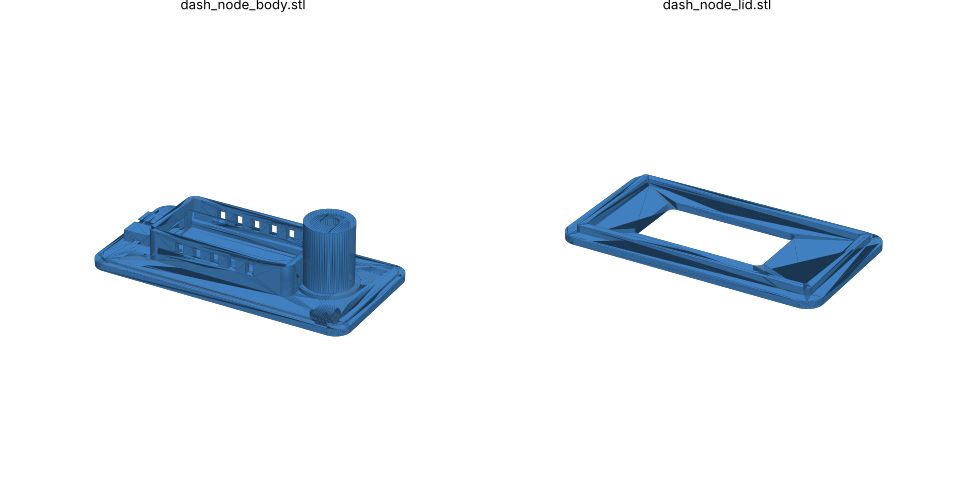
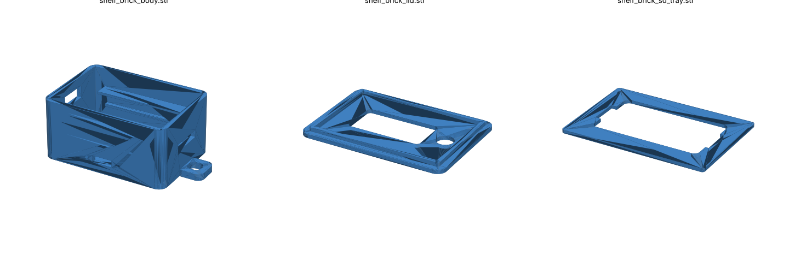

# Heltec V3 / V4 Car & Pocket Enclosures




Two printable cases for the Heltec WiFi LoRa 32 V3 and V4 (same 51.7 × 25.4 mm outline).

## 1. Dash Node (MeshMule car node)
Files: `dash_node_body.stl`, `dash_node_lid.stl`

- One-piece base + board tub + hollow antenna tower (~38 mm tall).
- Antenna screws on top of the tower, straight up = omnidirectional.
- USB-C hole in the front wall + a cord saddle with a zip-tie slot (strain relief), so the cable stays plugged in while driving.
- Underside: shallow recess for a silicone grip pad / dash-mat square, plus four 10 × 3 mm magnet pockets.
- Side vents for heat.

**Parts (~$10):**
- IPEX (U.FL) → SMA-female bulkhead pigtail, ~10 cm (V3 = IPEX 1.0; V4 LoRa port = IPEX 1.0)
- 915 MHz SMA whip antenna (the stock one if it is SMA, or any 915 MHz whip)
- Right-angle (90°) USB-C cable, 1–2 m, + 12 V USB car charger
- Small zip tie, grip pad or 4 × 10×3 mm magnets (glue in with CA)

**Assembly:** push the pigtail up through the tower, bolt the SMA bulkhead to the top with its nut + washer, snap the board in on the rails (screen up, USB-C toward the front hole), clip the pigtail to the LoRa IPEX port, press the lid on. Always connect the antenna before powering on.

## 2. Shelf Brick (Shelf Lite / Wi-Fi thumb drive / logger)
Files: `shelf_brick_body.stl`, `shelf_brick_lid.stl`, `shelf_brick_sd_tray.stl`

Deck-of-cards brick (67 × 40 × 40 mm with lid). Three levels:
1. **Bottom:** 103450 LiPo pouch (≈2000 mAh, 50 × 34 × 10 mm) with JST 1.25 mm plug.
2. **Middle:** SD tray holding the 6-pin SPI microSD module; card slot opens at the back end.
3. **Top:** Heltec board on rails; OLED window in the lid.

- Upright SMA antenna through the lid (same pigtail as above).
- Slide switch cut-out (SS12D00) on the side, in the battery + lead.
- USB-C at the front for charging. Lanyard loop. Two magnet pockets underneath.

## Printing
- **Material: PETG or ASA, not PLA.** A dash in the sun hits 70–80 °C and PLA will sag.
- 0.2 mm layers, 3 walls, 20 % infill. No supports needed (lid prints top-face down).
- Print a lid first to check the OLED window and the board fit; fit/clearances are at the top of `build.py`.

## Safety
- **Do not leave the LiPo (Shelf Brick) on a hot dashboard.** Keep it in the cabin or glovebox in summer, or use the Dash Node (USB-powered, no battery) for the car.
- In the Dash Node, leave the board's battery port empty.

## Changing the design
Everything is parametric in `build.py` (Python):
```
pip install manifold3d trimesh numpy
python3 build.py      # writes the STLs to ./stl
```
Useful knobs: `FIT`, `OLED_WIN`, `OLED_OFF`, `USBC`, `SMA_HOLE`, `MAGNET`, `LIPO`, `SDMOD`, and `TOWER_H` inside `dash_node()`.
